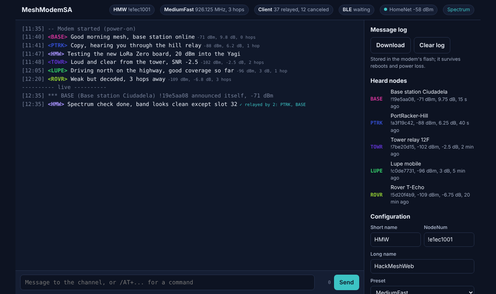
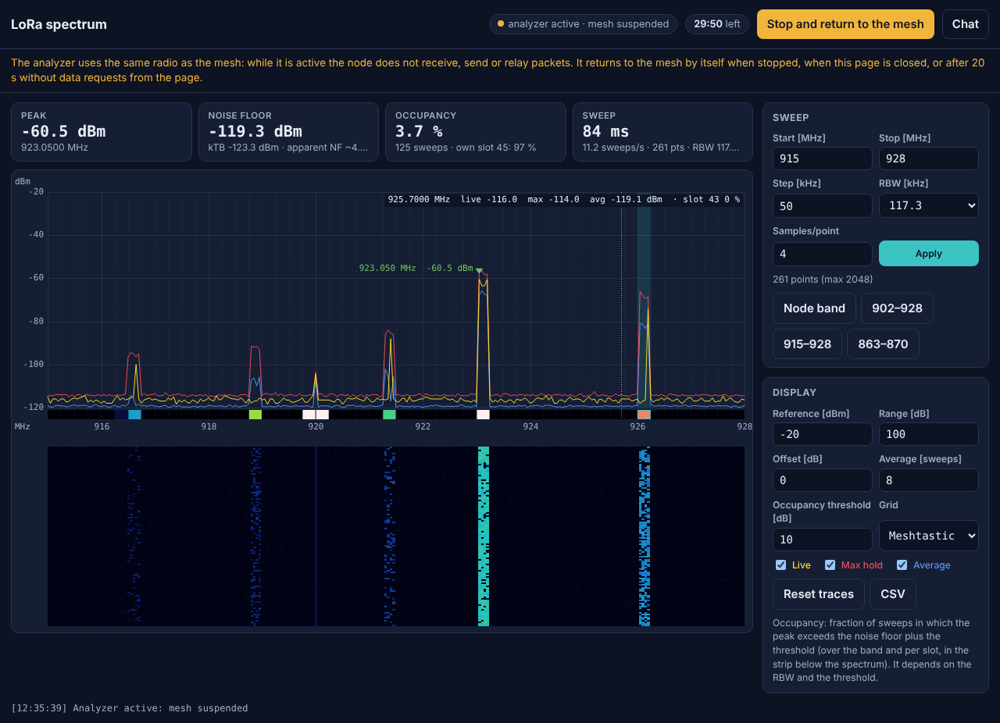
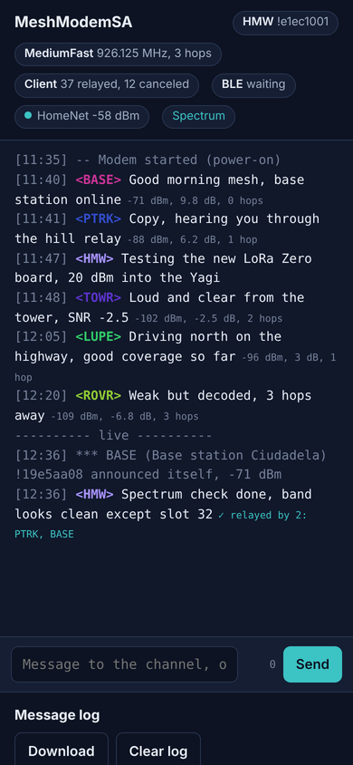
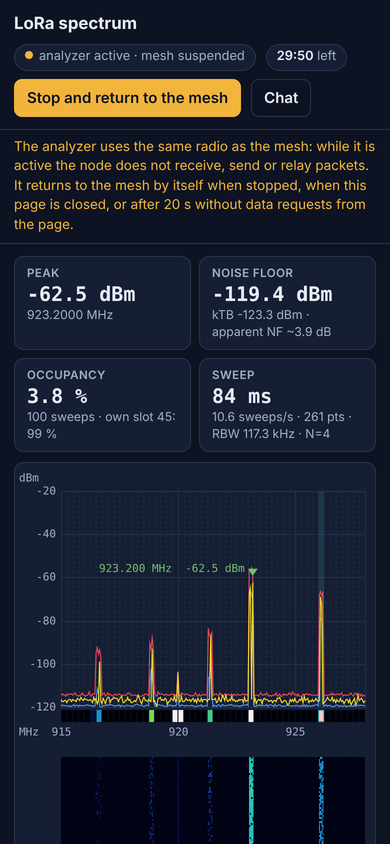
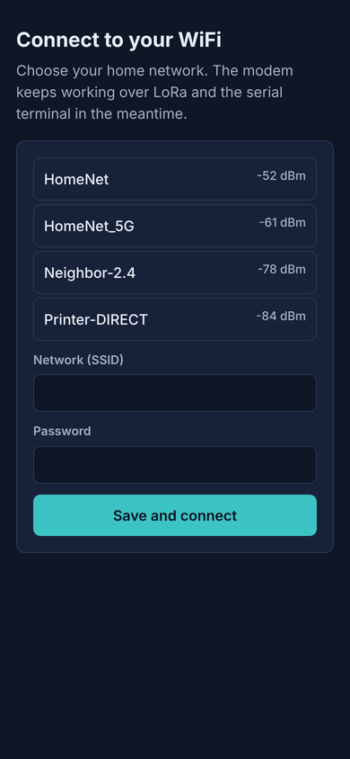

# MeshModemSA — AT-command modem + LoRa spectrum analyzer

Firmware for the **ESP32 LoRa Zero** (ELECTGPL): a LoRa node compatible with the Meshtastic 2.x network that you drive with AT commands from a serial terminal, from a web browser over WiFi, or from your phone over Bluetooth LE. It also includes an SX1262 **spectrum analyzer** on the same embedded web server, to see how busy the LoRa band is at a given location.

<p align="center">
  
</p>

```
 Serial terminal ── USB ──┐
 Web browser ────── HTTP ─┼──► single AT interpreter ──► SX1262 ──► Meshtastic mesh
 Phone / PC ─────── BLE ──┘    (all three interfaces see the same output)
                               └─► /spec: spectrum analyzer (exclusive mode)
```

- **Mesh:** default primary channel (public PSK `AQ==`), text broadcast and NodeInfo, rebroadcasting following the rules of the official firmware (managed flooding) in three modes: mute, client and router. Echoes of your own messages are detected as an implicit ACK ("relayed by N").
- **Interfaces:** USB serial, web over WiFi (home network or the modem's own network) and Bluetooth LE (Nordic UART Service). All of them share the same AT interpreter and see the same output.
- **Message log:** messages are stored in flash (LittleFS) with date and time and survive reboots.
- **Spectrum analyzer:** SX1262 sweep in GFSK mode with the RxBw filter as the RBW. Live trace, max hold, average, waterfall, Meshtastic slot grid and per-slot occupancy, in the browser at `/spec`.

> Meshtastic® is a registered trademark of Meshtastic LLC. This is an independent project, not affiliated with Meshtastic. It is not compatible with the official Meshtastic app, which uses its own protobuf API (`ToRadio`/`FromRadio`) rather than a BLE serial port.

---

## Screenshots

Screenshots taken with simulated data (node names, messages and signals are examples).

| Spectrum analyzer (`/spec`) |
|---|
|  |

| Chat on a phone | Analyzer on a phone | WiFi setup (`/setup`) |
|---|---|---|
|  |  |  |

---

## Repository contents

| File | Description |
|---|---|
| `MeshModemSA/MeshModemSA.ino` | Firmware (Arduino IDE). The chat and analyzer web pages are embedded. Pin definitions in the `Hardware` block ([wiring](#wiring-sx1262--esp32-s3)) |
| `mesh_ble.html` | Bluetooth chat page (Web Bluetooth), to be served from GitHub Pages |
| `docs/` | README screenshots |

The Arduino IDE requires the `.ino` to live in a folder with the same name (`MeshModemSA/`).

## Hardware: ESP32 LoRa Zero rev 1.0

| Block | Details |
|---|---|
| MCU | ESP32-S3 without internal flash or PSRAM, external GD25Q128 16 MB flash, native USB on USB-C |
| Radio | SX1262 with a 32 MHz TCXO powered from DIO3 at 1.8 V, SX1262 DC-DC regulator, IPD915 filter, BGS12WN6E6327 RF switch driven by DIO2, U.FL connector |
| SX1262 pins | NSS 8, SCK 9, MOSI 10, MISO 11, RST 12, BUSY 13, DIO1 14 |
| Power | USB-C or 5 V from the 2×20 header (ORed by an LM66200), TPS631000 buck-boost to 3.3 V |
| Other | BOOT (GPIO0) and RESET buttons, always-on power LED. Raspberry Pi Zero form factor and 2×20 header |

No battery, fuel gauge or GPIO-driven LEDs. The assembled PCBA uses a TPS2116 instead of the LM66200 and a TG2520SMN TCXO instead of the X1G0054210205 shown in the schematic.

## Wiring: SX1262 ↔ ESP32-S3

The ESP32 LoRa Zero is a custom board that is not sold, so this is the full radio wiring in case you want to build the modem on another board or on a breadboard with an SX1262 module.

| SX1262 signal | SX1262 pin (QFN-24) | ESP32-S3 GPIO | Define in the `.ino` | Notes |
|---|---|---|---|---|
| NSS (chip select) | 19 | GPIO8 | `PIN_CS` | 10 kΩ pull-up to 3.3 V on the board |
| SCK | 18 | GPIO9 | `PIN_SCK` | SPI (FSPI host, routed through the GPIO matrix) |
| MOSI | 17 | GPIO10 | `PIN_MOSI` | |
| MISO | 16 | GPIO11 | `PIN_MISO` | |
| NRESET | 15 | GPIO12 | `PIN_RST` | Also used by RadioLib to reset the chip when leaving the analyzer |
| BUSY | 14 | GPIO13 | `PIN_BUSY` | Polled before every SPI command |
| DIO1 | 13 | GPIO14 | `PIN_DIO1` | RX/TX done interrupt, read by polling |
| DIO2 | 12 | — | `DIO2_RFSW` | Drives the RF switch (TX/RX), not connected to the ESP32 |
| DIO3 | 6 | — | `TCXO_V` | Powers the 32 MHz TCXO at 1.8 V, not connected to the ESP32 |
| VDD_IN, VBAT, VBAT_IO | 1, 10, 11 | 3.3 V | — | |

Other pins used by the firmware: **GPIO0** (BOOT button, held 5 s opens the WiFi portal) and the native USB on **GPIO19/20** (serial terminal). No other GPIO is used.

### Using another board

All the hardware definitions are in the `Hardware` block at the top of the `.ino`:

1. **Pins:** set `PIN_CS`, `PIN_SCK`, `PIN_MOSI`, `PIN_MISO`, `PIN_RST`, `PIN_BUSY` and `PIN_DIO1` to your wiring. On the ESP32-S3 any free GPIO works for the SPI bus, but avoid the strapping pins (0, 3, 45, 46), the native USB pins (19, 20), the flash pins (26 to 32) and, on modules with octal PSRAM, 33 to 37.
2. **Oscillator:** `TCXO_V 1.8f` for modules with a TCXO powered from DIO3 (the usual case for 868/915 MHz modules); `TCXO_V 0` for modules with a plain crystal.
3. **RF switch:** `DIO2_RFSW true` when DIO2 drives the antenna switch. Modules that need separate RXEN/TXEN GPIOs (for example Ebyte E22 modules, or the Wio-SX1262 with its RXEN line) are not supported as-is: they need `radio.setRfSwitchPins(rxen, txen)` after `radioBegin()` in `setup()` and in `specExit()`, and the RX enable pin driven high during the analyzer sweep.
4. **Band and node:** `BAND_START` / `BAND_END` for your region, and a unique `NODE_ID`.
5. **Flash:** choose the partition scheme for your flash size. The message log mounts whichever `spiffs` or `ffat` partition exists, so 4 MB and 8 MB schemes that include one of them also work.

Reference boards (pins taken from the official Meshtastic firmware variants; not tested with this firmware):

| Board | NSS | SCK | MOSI | MISO | RST | BUSY | DIO1 | RF switch | TCXO | Changes needed |
|---|---|---|---|---|---|---|---|---|---|---|
| ESP32 LoRa Zero (this project) | 8 | 9 | 10 | 11 | 12 | 13 | 14 | DIO2 | 1.8 V | None |
| Heltec WiFi LoRa 32 V3 | 8 | 9 | 10 | 11 | 12 | 13 | 14 | DIO2 | 1.8 V | Pins are identical; only the partition scheme for its 8 MB flash |
| Seeed XIAO ESP32-S3 + Wio-SX1262 | 41 | 7 | 9 | 8 | 42 | 40 | 39 | DIO2 + RXEN on GPIO38 | 1.8 V | Pins, plus RXEN control (see step 3) |

## Building (Arduino IDE)

**Libraries:** RadioLib 7.x or 8.x (the only external one; tested with 7.8.1 and 8.0.0) and the arduino-esp32 3.x core. WiFi, WebServer, DNSServer, ESPmDNS, Preferences, LittleFS and BLE (NimBLE) come with the core.

| Option | Value |
|---|---|
| Board | ESP32S3 Dev Module |
| USB CDC On Boot | **Enabled** (terminal over USB-C) |
| Flash Size | **16MB (128Mb)** |
| PSRAM | **Disabled** |
| Partition Scheme | **16M Flash (3MB APP/9.9MB FATFS)** (recommended) or **Custom** |

With "USB CDC On Boot: Disabled", the serial port is U0TXD/U0RXD (GPIO43/44) on the 2×20 header.

Two partition schemes work, and the firmware adapts automatically:

- **"16M Flash (3MB APP/9.9MB FATFS)"**, with no `partitions.csv` in the sketch folder: two 3 MB application slots and about 9.9 MB of message log in the `ffat` partition.
- **"Custom"** with a `partitions.csv`: two 4 MB slots and about 7.9 MB of message log in the `spiffs` partition.

At boot the firmware looks for a `spiffs` partition and falls back to `ffat`. Either way it is formatted as LittleFS the first time.

**If you use the menu scheme, remove `partitions.csv` from the sketch folder:** the core picks it up automatically if it is present, regardless of the menu selection. Changing the partition table erases the message log; NVS (WiFi and configuration) is preserved. The firmware takes about 1.4 MB.

Before building, review the `CONFIG` block in the `.ino`: `NODE_ID` (unique per board), names, preset, band (ANZ 915–928 MHz by default), BLE PIN and the password of the modem's own network.

---

## Ways to access the device

| Method | Requires | Chat and AT | Analyzer | Best for |
|---|---|---|---|---|
| 1. Serial terminal | USB-C cable | Yes | Commands only | Bench, initial setup |
| 2. Web over the home network | Home WiFi | Yes | Yes (`/spec`) | PC and phone at home |
| 3. Web over the modem's own network | Nothing (the modem is the AP) | Yes | Yes (`/spec`) | Field use from a phone |
| 4. BLE with terminal apps | BLE app | Yes (AT text) | Commands only | Quick tests without WiFi |
| 5. `mesh_ble.html` | Browser with Web Bluetooth | Yes | No | Chat in the field without WiFi |

### 1. Serial terminal (USB)

Arduino IDE serial monitor, PuTTY, Tera Term or Thonny, at 115200 8N1 (with USB CDC the baud rate does not matter). Each command ends with CR, LF or CR+LF. To start: `ATI` (full configuration and status) and `AT+HELP`.

The whole node is configured from the terminal (see [AT commands](#at-commands)), and you can also use the mesh:

```
AT+SEND=hello from the terminal        sends a message to the channel
+TX:1a2b3c4d                           transmitted
+ECO:1a2b3c4d,relay=5C,ABCD,-92,6.5,2  another node relayed it
+RX:!a1b2c3d4,!ffffffff,-101,-3.2,1,hi a message was received
AT+NODES                               heard nodes
AT+LOG=20                              last 20 log entries
```

Everything that happens on the web and over BLE is mirrored on the terminal: commands received through those interfaces appear as `[web] command` and `[ble] command`.

### 2. Web over the home network (STA mode)

```
AT+WIFI=MyNetwork,MyPassword
```

The credentials are stored and the modem connects. `ATI` and `AT+WIFI?` report the IP:

- **Chat:** `http://meshmodem.local/` or `http://<ip>/`
- **Analyzer:** `http://meshmodem.local/spec`
- **Full message log:** `http://meshmodem.local/log.jsonl`

PC and phone keep their internet access because they are on the same network as the modem. If the `.local` name does not resolve (some Android devices), use the IP. You can also enter the network without a terminal: with no saved credentials, or holding BOOT for 5 s, the modem brings up an open captive portal `MeshModem-XXXX` with the setup page at `http://192.168.4.1`.

### 3. Web over the modem's own network (AP mode, for the field)

Without the home network, the modem brings up **its own WiFi network** with the full web interface. No internet needed.

| `AT+WIFIMODE` | Behavior |
|---|---|
| `AUTO` (default) | Tries the home network. If it does not connect within 20 s, it brings up its own network until the next reboot. With no credentials it goes straight to its own network |
| `STA` | Home network only. With no credentials, it opens the configuration portal |
| `AP` | Always its own network |

- **Network:** `MeshModem-XXXX`, WPA2 with password `meshmodem` (`AP_PASS`). Change it with `AT+APPASS=new_password` (8 to 63 characters); `AT+APPASS=` with no value leaves it open.
- **Chat:** `http://192.168.4.1/` · **Analyzer:** `http://192.168.4.1/spec` · **Home network:** `http://192.168.4.1/setup`.
- **iPhone:** Settings → Wi-Fi → `MeshModem-XXXX` → password. iOS warns "No Internet Connection" but stays connected and uses mobile data for everything else. With *Share → Add to Home Screen*, the chat behaves like an app.
- **PC:** it can join this network too, but meanwhile its WiFi adapter has no internet (unless it also has a wired connection). Method 2 is more convenient for a PC.
- **Time:** without NTP, the modem takes the time from the browser when the page opens (`AT+TIME=`), so the message log gets real timestamps.

`AT+WIFI?` replies `+WIFI:AP,MeshModem-XXXX,192.168.4.1,CLIENTS=1,MODE=AUTO`.

### 4. Bluetooth LE with terminal apps

It uses the **Nordic UART Service (NUS)**, the de facto standard for a serial port over BLE:

| | UUID |
|---|---|
| Service | `6E400001-B5A3-F393-E0A9-E50E24DCCA9E` |
| RX (written by the phone) | `6E400002-B5A3-F393-E0A9-E50E24DCCA9E` |
| TX (notified by the modem) | `6E400003-B5A3-F393-E0A9-E50E24DCCA9E` |

- **Name:** `MeshModem-XXXX`. Works without WiFi.
- **Pairing:** writing requires pairing with a PIN (fixed passkey, MITM, Secure Connections and bonding). The default PIN is `123456` (`BLE_PIN`); change it with `AT+BLEPIN=nnnnnn`, applied on reboot. With `AT+BLEPIN=0` it is open: anyone nearby could send commands.
- **Commands:** each one ends with CR or LF. If the app adds no terminator, the command runs after 300 ms of silence.
- **Responses:** notifications of up to MTU−3 bytes (MTU 247 is requested).

Tested apps:

- **Android:** *Serial Bluetooth Terminal* (Kai Morich). Devices → Bluetooth LE → `MeshModem-XXXX`, then type `ATI`.
- **Android / iOS:** *nRF Connect*. Connect, open the Nordic UART service, enable notifications on TX and write UTF-8 text to RX.
- **Bluefruit Connect:** UART mode.

### 5. Bluetooth chat: `mesh_ble.html`

A Web Bluetooth page with the same chat as the modem's web page, connected over BLE, without WiFi:

- **Tabs:** *Chat* (messages, NodeInfo, "✓ relayed by N" / "✗ no echo"), *Nodes* and *Terminal* (raw modem lines and an input line for AT commands).
- **On connection** it requests `ATI`, `AT+NODES` and `AT+LOG=30`, sets the phone time and keeps updating live. In the chat, a line starting with `/` is sent as an AT command.

The page must be served over `https://`. With GitHub Pages enabled on this repository it is available at `https://<user>.github.io/<repo>/mesh_ble.html`. It does not depend on the modem, so it can be saved to the home screen.

| Platform | Browser |
|---|---|
| iPhone / iPad | **Bluefy** (free). Safari and Chrome on iOS do not implement Web Bluetooth |
| Android | Chrome |
| Windows / Mac / Linux | Chrome or Edge |

---

## Meshtastic compatibility: what goes over the air

The modem does not use the Meshtastic firmware or its libraries. It builds and parses the same on-air packets from scratch, which is why it talks to regular Meshtastic 2.x nodes on the default primary channel. This section describes each layer and where it lives in the code.

### Frame at a glance

The complete frame, from the radio layer down to the text the user typed:

```
 LoRa PHY (SX1262)
 ┌──────────────┬──────────┬─────────────┬───────────────────────────────────────────┬────────┐
 │ Preamble     │ Sync word│ PHDR        │ PHY payload (16 + N bytes, N ≤ 239)       │ CRC16  │
 │ 16 symbols   │ 0x2B     │ len,CR,CRC  │                                           │        │
 └──────────────┴──────────┴─────────────┴───────────────────────────────────────────┴────────┘
                                          │
          ┌───────────────────────────────┘
          ▼
 Meshtastic packet
 ┌────────┬────────┬────────┬─────┬─────┬─────┬─────┬──────────────────────────────────────┐
 │ to     │ from   │ id     │flags│hash │n.hop│relay│ AES-128-CTR ciphertext (N bytes)     │
 │ 4 B LE │ 4 B LE │ 4 B LE │ 1 B │ 1 B │ 1 B │ 1 B │                                      │
 └────────┴────────┴────────┴─────┴─────┴─────┴─────┴──────────────────────────────────────┘
 ◄─────────── 16-byte header, in clear ────────────►│ decrypt with PSK + nonce(id, from)
                                                    ▼
 protobuf Data (plaintext)
 ┌──────┬─────────┬──────┬────────┬───────────────────────────┐
 │ 0x08 │ portnum │ 0x12 │ length │ payload bytes             │
 │ tag 1│ varint  │ tag 2│ varint │ UTF-8 text  or  User msg  │
 └──────┴─────────┴──────┴────────┴───────────────────────────┘
```

Each layer is described below, followed by a byte-by-byte example of a real packet.

### 1. LoRa physical layer

| Parameter | Value | Code |
|---|---|---|
| Modulation | LoRa, explicit header, CRC on | `radioBegin()` |
| Sync word | `0x2B` (Meshtastic private network) | `radioBegin()` |
| Preamble | 16 symbols | `radioBegin()` |
| BW / SF / CR | From the modem preset, same table as the official firmware | `PRESETS[]` |

| Preset | BW [kHz] | SF | CR |
|---|---|---|---|
| ShortTurbo | 500 | 7 | 4/5 |
| ShortFast | 250 | 7 | 4/5 |
| ShortSlow | 250 | 8 | 4/5 |
| MediumFast | 250 | 9 | 4/5 |
| MediumSlow | 250 | 10 | 4/5 |
| LongTurbo | 500 | 11 | 4/8 |
| LongFast | 250 | 11 | 4/5 |
| LongMod | 125 | 11 | 4/8 |
| LongSlow | 125 | 12 | 4/8 |

### 2. Frequency slot

Like `RadioInterface.cpp` in the official firmware, the frequency is derived from the channel name. For the default primary channel the name is the preset name (`"MediumFast"`, `"LongFast"`...):

```
num_slots = floor((band_end - band_start) / BW)
slot      = djb2(channel_name) % num_slots
freq      = band_start + BW/2 + slot × BW
```

Example, MediumFast on ANZ (915–928 MHz, BW 250 kHz): 52 slots, `djb2("MediumFast") % 52 = 44`, so the frequency is 915 + 0.125 + 44 × 0.25 = **926.125 MHz**, reported by `ATI` as `SLOT=45/52` (1-based). `AT+FREQ` overrides it. Code: `derive()`.

### 3. Packet header (16 bytes, unencrypted)

```
 0        4        8        12  13  14  15  16
 ├────────┼────────┼────────┼───┼───┼───┼───┼─────────────────────────┐
 │   to   │  from  │   id   │flg│ch │nh │rly│ encrypted payload ...    │
 └────────┴────────┴────────┴───┴───┴───┴───┴─────────────────────────┘
   u32 LE   u32 LE   u32 LE
```

| Byte | Field | Value sent by this modem |
|---|---|---|
| 0–3 | `to` | `0xFFFFFFFF` (broadcast) |
| 4–7 | `from` | Own NodeNum (`NODE_ID`, `AT+NODE`) |
| 8–11 | `id` | Random packet ID (`esp_random() \| 1`) |
| 12 | flags | bits 0–2 `hop_limit`, bit 3 `want_ack` (0), bit 4 `via_mqtt` (0), bits 5–7 `hop_start` (both = `AT+HOP`) |
| 13 | channel hash | XOR of the channel name bytes XOR the XOR of the key bytes |
| 14 | `next_hop` | 0 (no preferred next hop) |
| 15 | `relay_node` | Last byte of the own NodeNum |

`hop_start − hop_limit` gives the number of hops a received packet has travelled (the `hops` field of `+RX`). The channel hash for MediumFast with the default key is `0x1F` (`ATI` shows it as `HASH=1F`). Code: `sendData()`, `receive()`.

### 4. Encryption: AES-128-CTR

- **Key:** the default channel key `AQ==` (one byte, `0x01`) expands to the well-known 16-byte key `d4f1bb3a20290759f0bcffabcf4e6901`.
- **Counter block (nonce):** `id` as 64-bit little-endian (bytes 0–7, upper half zero), `from` as 32-bit little-endian (bytes 8–11), and a 32-bit block counter (bytes 12–15) incremented as a big-endian 128-bit integer, same as `mbedtls_aes_crypt_ctr`.
- CTR is symmetric, so the same function encrypts and decrypts. The firmware has its own AES-128 implementation (FIPS-197), with no external crypto library.

Code: `aesKeyExpand()`, `aesBlock()`, `ctr()`.

### 5. Payload: protobuf `Data`

After decryption the payload is a protobuf `Data` message. The firmware encodes and decodes it by hand (varints and length-delimited fields):

| Field | Number | Use |
|---|---|---|
| `portnum` | 1 (varint) | `1` = TEXT_MESSAGE_APP, `4` = NODEINFO_APP |
| `payload` | 2 (bytes) | UTF-8 text, or a protobuf `User` for NodeInfo |

The NodeInfo it sends (at boot, every 3 hours, after `AT+NAME` / `AT+NODE` / `AT+PRESET` / `AT+RELAY`, and with `AT+NI`) is a `User` message:

| `User` field | Number | Value |
|---|---|---|
| `id` | 1 | `"!xxxxxxxx"` |
| `long_name` | 2 | `AT+NAME` long name |
| `short_name` | 3 | `AT+NAME` short name |
| `hw_model` | 5 | `PRIVATE_HW` (255) |
| `role` | 7 | `CLIENT_MUTE` (1), `CLIENT` (0, omitted) or `ROUTER` (2), following `AT+RELAY` |
| `is_unmessagable` | 9 | `true`: other apps will not offer direct messages to this node |

On reception, packets whose channel hash matches are decrypted; text and NodeInfo are reported (`+RX`, `+NODE`) and other ports are ignored (shown as `+PKT` with `AT+RAW=1`). Code: `pbNext()`, `sendNodeInfo()`.

### Worked example: a text message, byte by byte

The text `Hola mesh` sent by node `!e1ec1001` on MediumFast, default key, `AT+HOP=3`, packet ID `0x1A2B3C4D`. The bytes below were produced with the firmware's own `aesKeyExpand()` / `ctr()` compiled on a PC, and cross-checked with an independent AES-CTR implementation (Python `cryptography`).

**Plaintext `Data` (13 bytes):**

```
08 01                          field 1 (portnum), varint 1 = TEXT_MESSAGE_APP
12 09                          field 2 (payload), length 9
48 6f 6c 61 20 6d 65 73 68     "Hola mesh"
```

**Counter block (nonce) for AES-128-CTR:**

```
4d 3c 2b 1a 00 00 00 00 | 01 10 ec e1 | 00 00 00 00
└── id, 64-bit LE ────┘   └ from LE ─┘   └ counter ┘
```

**Frame on air (29 bytes = PHY payload):**

| Offset | Bytes | Field | Meaning |
|---|---|---|---|
| 0 | `ff ff ff ff` | `to` | Broadcast |
| 4 | `01 10 ec e1` | `from` | `0xE1EC1001` → `!e1ec1001` |
| 8 | `4d 3c 2b 1a` | `id` | `0x1A2B3C4D` |
| 12 | `63` | flags | `0b011_0_0_011`: `hop_start` = 3, `via_mqtt` = 0, `want_ack` = 0, `hop_limit` = 3 |
| 13 | `1f` | channel hash | xor(`"MediumFast"`) ^ xor(PSK) |
| 14 | `00` | `next_hop` | None |
| 15 | `01` | `relay_node` | Last byte of `from` |
| 16 | `9a 9c 84 de ae d8 cf 9a 52 28 b4 1e 3e` | ciphertext | The 13 plaintext bytes above, encrypted |

After one rebroadcast by a node `!xxxxxx7a`, the same frame comes back with only two bytes changed: byte 12 becomes `62` (`hop_limit` 2, so 1 hop travelled) and byte 15 becomes `7a`. The ciphertext is identical, which is why relays do not need the key and why the sender can recognize its own echo by `from` + `id`.

### 6. Rebroadcast (managed flooding)

Following `NextHopRouter::perhapsRebroadcast()` and `RadioInterface::getTxDelayMsecWeighted()`:

- A received packet is queued for rebroadcast if it is not addressed to this node, `hop_limit > 0`, it was not seen before, and `next_hop` is 0 or this node. It does not need to be decrypted, so packets from other channels and other nodes' DMs are relayed too (like the official `ALL` rebroadcast mode).
- Before relaying, `hop_limit` is decremented and `relay_node` is set to this node; `hop_start` and the payload are untouched.
- **Delay:** contention window CW = map(SNR, −20..10 dB → 3..8) and slot time = CAD time + 7.6 ms. Client: `2 × 8 × slot + random(0, 2^CW) × slot`, so nodes with a weaker signal (further away) relay first. Router: `random(0, 2 × CW) × slot`, always ahead of the clients.
- **Cancellation:** a client drops its pending rebroadcast if it hears another node relay the same packet first (duplicate `from` + `id`). A router never cancels.
- **Echo detection:** when a neighbor relays one of our own packets, the modem hears it again with the same `from` + `id` and a different `relay_node`. That is reported as `+ECO` ("relayed by N"), an implicit ACK without `want_ack`.

Code: `scheduleRelay()`, `cancelRelay()`, `serviceRelay()`.

### What is not implemented

- Direct messages and PKI encryption (Meshtastic 2.5+ public-key DMs), hence `is_unmessagable`.
- `want_ack` / routing ACKs, traceroute, position, telemetry and the other port numbers (they are relayed but not decoded).
- Secondary channels and custom keys: only the default primary channel with the `AQ==` key.
- The phone app API (`ToRadio` / `FromRadio` over BLE or serial): this modem uses AT commands instead.

---

## Spectrum analyzer

A tool to see how busy the LoRa band is at a given location. It uses the same radio as the mesh, so it works in **exclusive mode**:

- **While it is active, the node does not receive, send or relay packets.** On entry, pending rebroadcasts are dropped. NodeInfo requested meanwhile (periodic, `AT+NAME`, `AT+PRESET`...) stays pending and is sent on return. `AT+SEND` and `AT+NI` reply `ERROR` with `+SPEC:ACTIVE`.
- **Radio changes** (`AT+PRESET`, `AT+FREQ`, `AT+PWR`...) are accepted and applied when returning to the mesh.
- **It returns to the mesh by itself:** with "Stop", with `AT+SPEC=0`, when the page is closed, after **20 s without** `/api/spec` requests (`SA_LEASE_MS`) or after **30 min** (`SA_MAX_MS`). On return, the radio is re-initialized with the same sequence as `setup()`: reset through RST and `begin()`.
- **Measurement:** modem in GFSK with the RxBw filter as the RBW (4.8 to 467 kHz). Per point: `SetRfFrequency` → continuous `SetRx` → settling → N × `GetRssiInst`, with a peak detector and an average in linear power. Direct SPI access, independent of the RadioLib version. The TCXO on DIO3 and the RF switch on DIO2 are preserved.
- **The sweep runs in slices** of 8 ms per `loop()` pass: web, BLE and UART keep responding.
- **By default it sweeps the node's band** (`AT+BAND`) with a 50 kHz step, 117.3 kHz RBW and N = 4. For ANZ that is 261 points and about 80 ms of measurement.
- **Occupancy:** fraction of sweeps in which the peak exceeds the noise floor (median of the average) plus an adjustable threshold (10 dB by default), over the whole band and per Meshtastic slot. It depends on the RBW and the threshold.

| Command | Function |
|---|---|
| `AT+SPEC=1` / `AT+SPEC=0` | Enters the analyzer (suspends the mesh) / returns to the mesh |
| `AT+SPEC?` | `+SPEC:ON,915.000,928.000,50.0,117.3,4,261,SETTLE=218us,SWEEPS=n,LEFT=s` |
| `AT+SPECCFG=f0,f1,step,rbw,n` | MHz, MHz, kHz, kHz (snapped to the nearest valid RBW), samples per point 1..64; up to 2048 points |

If you enter with `AT+SPEC=1` from the UART or BLE and nobody opens `/spec`, the modem returns to the mesh after 20 s. Repeating `AT+SPEC=1` renews the lease.

**One analyzer client at a time.** Each `/api/spec` read returns the maximum accumulated since the previous read and resets it: with two browsers open on `/spec`, each one would see only part of the peaks.

### What it can and cannot show

- **Noise floor** ≈ −174 + 10·log(RBW) + NF: about −117 dBm at 117 kHz. The mesh decodes down to about −127 dBm (SF9 / BW 250 kHz), so nodes received with negative SNR do not show up in the spectrum. It shows interference, band occupancy, strong bursts and LoRaWAN traffic.
- **Self-generated spurs to check** with a 50 Ω load on the U.FL: 904, 912, 920 and 928 MHz (8 MHz SPI clock harmonics), 920 MHz (40 MHz crystal × 23), 928 MHz (32 MHz TCXO × 29). A fixed spur shows up as a slot at 100 % occupancy. WiFi and BLE TX bursts can briefly raise the floor.
- **Outside 902–928 MHz** the IPD915 filter and the matching network attenuate the signal: readings there are only relative.

---

## AT commands

Changes take effect immediately. `AT+SAVE` stores the radio configuration in flash (NVS); without `AT+SAVE` it is lost on reboot. `AT&F` restores the values of the `CONFIG` block.

| Command | Function |
|---|---|
| `AT`, `AT+HELP`, `ATI` / `AT+INFO?` | Test, help, full configuration and status |
| `AT+NODE=!aabbccdd` | 32-bit NodeNum in hex (8 digits) |
| `AT+NAME=long[,short]` | Long name (≤ 39) and short name (≤ 4) |
| `AT+PRESET=?` / `AT+PRESET=MediumFast` | List of presets / preset by name or number (0..8) |
| `AT+BAND=915,928` | Band in MHz (ANZ 915,928 · US 902,928 · EU_868 869.4,869.65 · BR_902 902,907.5) |
| `AT+FREQ=926.125` / `AT+FREQ=0` | Manual frequency / automatic slot |
| `AT+HOP=3` | Max hops for packets originated by the node (0..7) |
| `AT+RELAY=0\|1\|2` | Rebroadcast: mute / client (default) / router |
| `AT+PWR=20` | TX power in dBm (−9..22) |
| `AT+SEND=text` | Text broadcast on the primary channel (≤ 232 bytes) |
| `AT+NI`, `AT+NODES` | Sends NodeInfo / list of heard nodes |
| `AT+SAVE`, `AT&F`, `AT+RST` | Save to flash / factory defaults / reboot |
| `AT+WIFI=ssid,password`, `AT+WIFI?` | Home network credentials / WiFi status |
| `AT+WIFIMODE=AUTO\|STA\|AP` | WiFi mode (stored) |
| `AT+APPASS=password` | Own network password (empty = open) |
| `AT+PORTAL` | WiFi configuration portal (or BOOT for 5 s) |
| `AT+TIME=epoch` | Time in UTC seconds, when there is no NTP |
| `AT+BLE=0\|1`, `AT+BLE?`, `AT+BLEPIN=nnnnnn` | Bluetooth off / on, status, PIN (0 = no PIN) |
| `AT+SPEC=1\|0`, `AT+SPEC?`, `AT+SPECCFG=...` | Spectrum analyzer (see above) |
| `AT+LOG=20`, `AT+LOGCLR` | Last N log entries / erase the log |
| `AT+RAW=0\|1` | Trace of everything received |

**Unsolicited responses:**

| Line | Meaning |
|---|---|
| `+RX:!from,!to,rssi,snr,hops,text` | Text message received |
| `+NODE:!from,rssi,snr,short,long` | NodeInfo received |
| `+TX:id` | Own message transmitted |
| `+ECO:id,relay=XX,name,rssi,snr,hop_limit` | Another node relayed one of your messages (`hop_limit` = HOP−1: direct neighbor; lower: further away) |
| `+ECO:id,0` | Nobody relayed it within 15 s |
| `+RELAY:!from,id,hop_limit` | Packet rebroadcast (with `AT+RAW=1`) |
| `+WIFI:UP,...`, `+WIFI:DOWN`, `+WIFI:AP,...`, `+WIFI:PORTAL,...`, `+WIFI:NOT_FOUND,...` | WiFi changes |
| `+BLE:CONNECTED`, `+BLE:DISCONNECTED` | Bluetooth connection changes |
| `+SPEC:ON,...`, `+SPEC:OFF,reason,RADIO=e` | Analyzer entry and exit |
| `[web] command`, `[ble] command` | Command received from the web or over BLE |

---

## HTTP API

Used by the embedded web pages; also handy to integrate the modem into your own scripts.

| Route | Method | Response |
|---|---|---|
| `/` | GET | Web chat (or the portal, when active) |
| `/spec` | GET | Spectrum analyzer page |
| `/setup` | GET | Home network setup |
| `/api/at` | POST `cmd=<command>` | AT command output as text, ending in `OK` or `ERROR` |
| `/api/info` | GET | JSON with configuration and status: node, names, preset, band, frequency, slot, `nch`, `bw`, power, rebroadcast, WiFi, BLE, `spec`, heard nodes |
| `/api/ev?since=N&seen=0\|1` | GET | New events since sequence N: `{"next":N,"ev":[...]}`. `seen=1` marks messages as read |
| `/api/log?n=N` | GET | Last N log entries (1..500): `{"next":N,"log":[...]}` |
| `/log.jsonl` | GET | Full message log, one JSON line per event |
| `/api/spec` | GET | Last sweep in binary (see below). Renews the analyzer lease. `409 OFF` if the analyzer is not active |
| `/scan`, `/wifi` | GET / POST | Network scan and credential entry (portal) |

Example with curl:

```
curl -d "cmd=ATI" http://meshmodem.local/api/at
curl -d "cmd=AT+SEND=hello from the PC" http://meshmodem.local/api/at
```

**`/api/spec` format** (little-endian, 32-byte header):

| Offset | Type | Field |
|---|---|---|
| 0 | 2 × char | `'S' 'A'` |
| 2 | u8 | version (1) |
| 3 | u8 | samples per point |
| 4 | u32 | sweep number |
| 8 | u32 | duration of the last sweep [µs] |
| 12 | f32 | start frequency [MHz] |
| 16 | f32 | step [kHz] |
| 20 | f32 | RBW [kHz] |
| 24 | u16 | n, number of points |
| 26 | u16 | sweeps accumulated since the previous read (0 = no new data) |
| 28 | u16 | seconds left in the session |
| 30 | u16 | settling time after `SetRx` [µs] |
| 32 | n × u8 | peak: maximum since the previous read |
| 32 + n | n × u8 | average of the last sweep |

Each byte is −2·P [dBm], the native `GetRssiInst` format: P = −byte / 2. In Python: `struct.unpack_from("<2sBBIIfffHHHH", body)`.

---

## Technical notes

- **BLE stack:** NimBLE, the one arduino-esp32 3.x ships for the S3. On core 3.3.0 the Security Manager is configured directly in `ble_hs_cfg`, because `BLESecurity::setStaticPIN()` does not link (the library declares static members it never defines). From 3.3.1 on, `BLESecurity::setPassKey()` is used.
- **Concurrency:** the NimBLE task only writes into a 512-byte ring buffer protected by a spinlock. All commands (UART, web and BLE) run in `loop()`, so the radio is never accessed concurrently. The analyzer also runs in `loop()`.
- **Coexistence:** WiFi and BLE share the S3's 2.4 GHz radio by time slicing. It is not noticeable for chat and commands.
- **RadioLib:** builds with 7.8.1 and 8.0.0. A compatibility layer isolates the API change of version 8 (`ConfigLoRa_t`, frequencies in Hz).
- **Own AES-128** in CTR mode, compatible with the official firmware's encryption (counter = id | from).

## License

MIT — see [LICENSE](LICENSE). Author: Electgpl.
